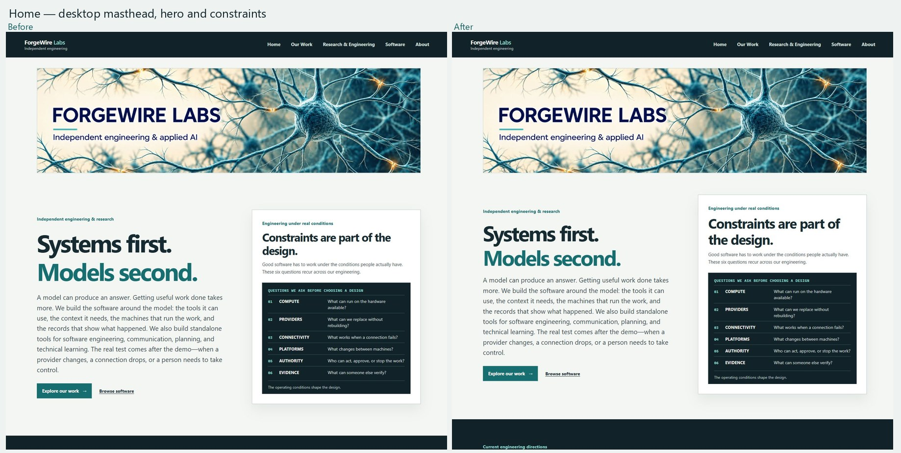
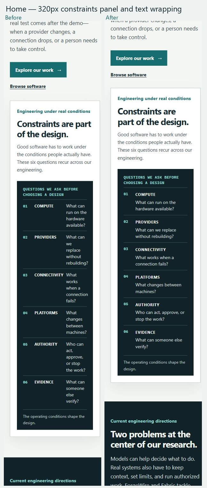
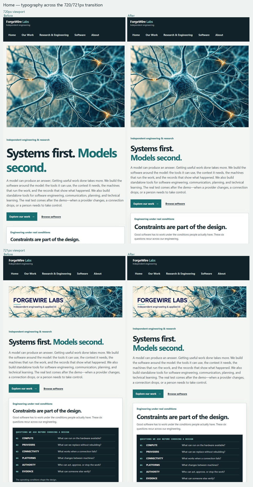
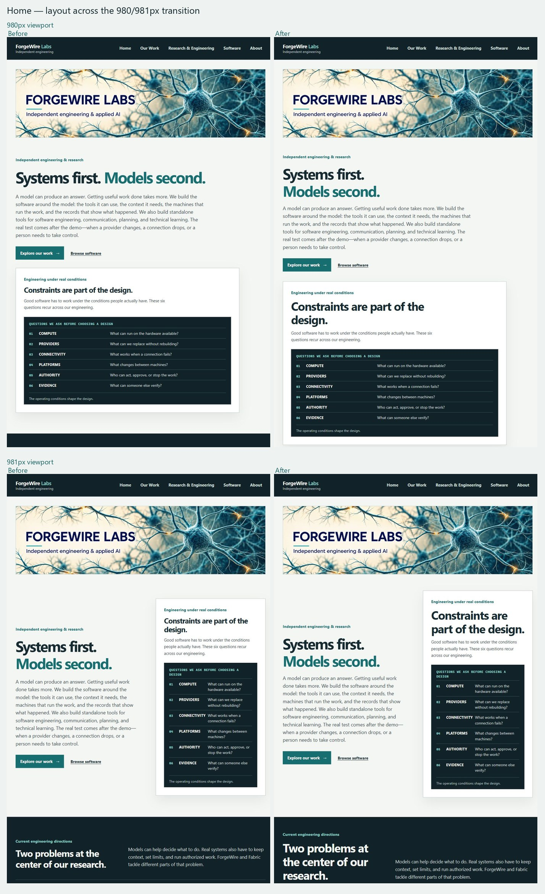
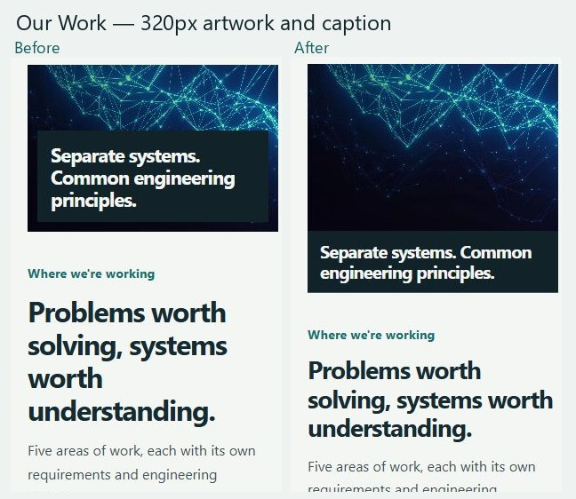
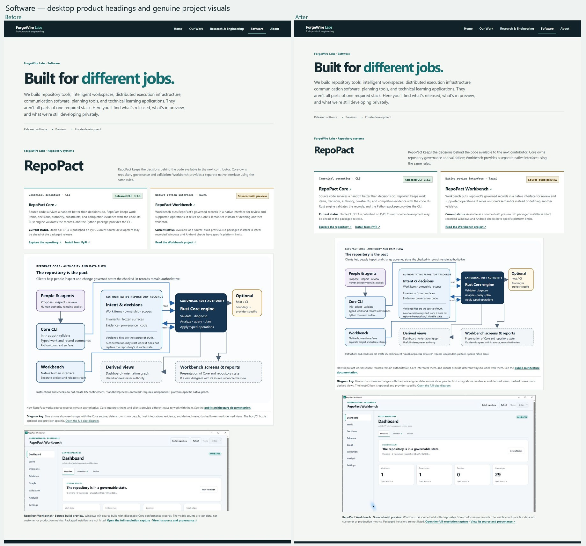
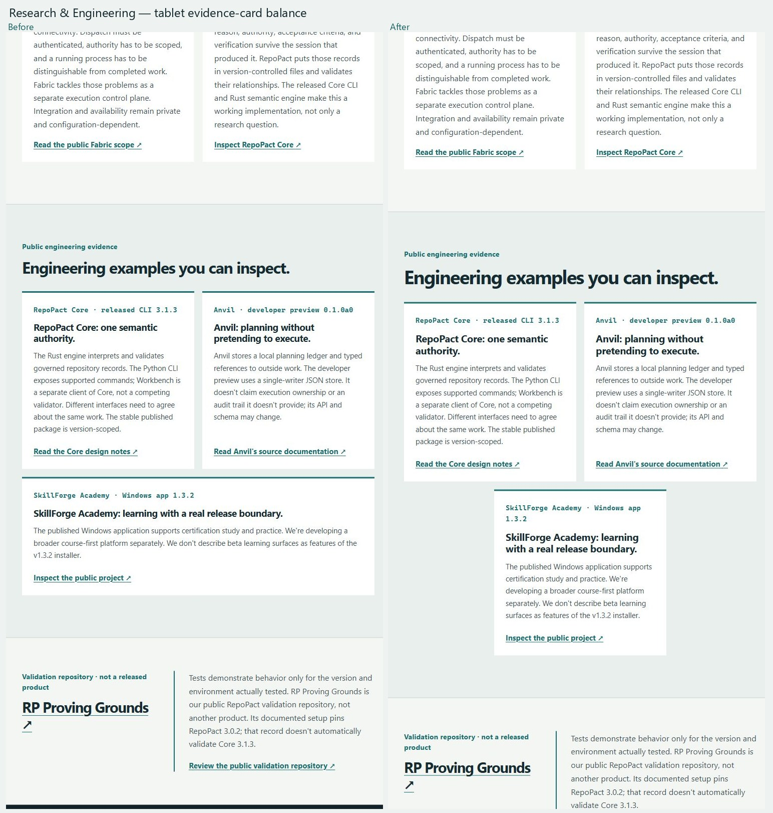
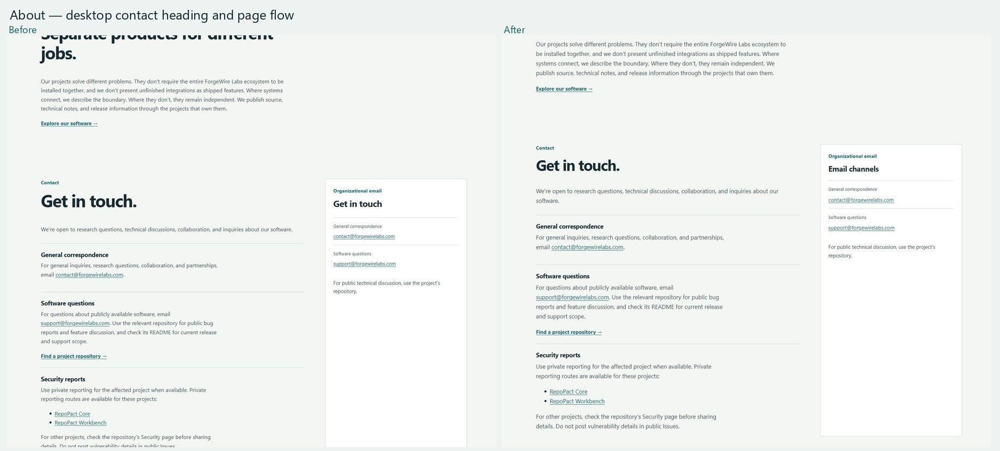

# Website visual refinement

**Review date:** 2026-10-26

**Base:** `9f20b0676c33f6fc58cafb867b796d37685d2af4`
**Scope:** typography, spacing, and responsive composition; no redesign or copy rewrite.

## Changes

- Replaced breakpoint-specific heading sizes with shared fluid page, section, product, and card scales. The homepage title now keeps its two phrases on separate balanced lines.
- Reduced excessive homepage and page-lead spacing with fluid values. Body text scales from 16px to 17px.
- At narrow widths, homepage questions place their prompt beneath the index and category. The Our Work caption follows its artwork below 460px.
- Matched the four Software project headings to one scale, constrained large diagrams and screenshots while retaining full-resolution links, and centered the last Research & Engineering card at tablet widths.
- Renamed the About contact-card heading to “Email channels” to remove the duplicate “Get in touch” heading.

Apart from the requested About contact-card heading, no approved copy, image source, project maturity label, link target, contact/security route, or deployment configuration changed.

## Responsive evidence

Baseline and revised full-page screenshots were captured for Home, Our Work, Research & Engineering, Software, and About at 320, 390, 720, 721, 768, 980, 981, and 1440px (40 screenshots per set). All 40 revised pages had no horizontal overflow, and all page images loaded.

| Measure | Baseline | Revised |
|---|---:|---:|
| Home H1 at 720 / 721px | 72 / 44.8px | 45.2 / 45.235px |
| Home H1 at 980 / 981px | 56.84 / 53.955px | 54.3 / 54.335px |
| Home question columns at 320px | 27 / 90 / 50px | 27 / 148px; prompt occupies the second row |
| Our Work caption at 320px | Overlaid on artwork | Static below artwork |
| Research & Engineering cards at 768px | 337 / 337 / 689px | 337 / 337 / 337px |
| Research & Engineering cards at 980px | 443 / 443 / 901px | 443 / 443 / 443px |
| Software section headings at 1440px | 72 / 64.8 / 60.48 / 60.48px | 48px each |

The 720/721 and 980/981 comparisons show continuous heading scaling and the expected one-column/two-column transition. The neural masthead and the homepage headline remain visually connected, with the large-screen top padding reduced from 118px to about 69px. The homepage question panel remains legible at 320px, with each prompt using a full-width second row. The Work image remains the approved artwork and the mobile caption no longer covers it. Software retains its authentic project diagrams and screenshots; the existing full-resolution capture link remains available. The tablet evidence cards now share a consistent width, with the third card centered in the half-width slot.

## Before and after

## Checks and limitations

The visual captures used a local browser viewport, not the blocked Windows Desktop workflow. Actual browser zoom at 200% and 400%, keyboard operation, and screen-reader output were not tested. Formal color-contrast analysis was not performed. The automated verifier checks one `h1` per route, image alternative attributes and dimensions, valid `aria-describedby` references, local references, external-resource restrictions, and responsive CSS regression invariants; it does not prove WCAG conformance. No WCAG 2.2 AA conformance claim is made.

Validation completed:

- `npm ci` — passed; 114 packages installed, 0 reported vulnerabilities.
- `npm run build` — passed; 5 reviewed routes generated.
- `npm run verify` — passed; production metadata, assets, content boundaries, local links, SVG safety, and responsive invariants checked.
- `npm run build:preview` — passed; 5 preview routes generated.
- `npm run verify:preview` — passed; preview `noindex, nofollow` metadata and preview paths checked.
- `git diff --check` — passed.
